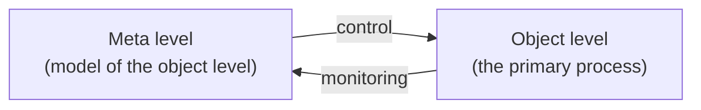

# Metacognition

A system's model of its own cognition — what it knows, how reliably, and what to do about it. In LLM work the term covers two distinct capabilities that are easy to conflate and that the evidence separates sharply.

## The two-level account, stated correctly

The canonical framework is **Nelson & Narens (1990)**. It has **two levels**:

- an **object level**, where the primary process runs;
- a **meta level**, holding a model of the object level.

They are connected by **two directional relations**: **monitoring** (object → meta, the meta level observes) and **control** (meta → object, the meta level acts).

> [!warning] Monitoring and control are flows, not tiers
> A common misreading turns this into three levels — an object level, a "monitoring level," and a "control level." That loses the property that makes the account work: **control acts on exactly the state monitoring produced.** Splitting them into separate tiers breaks the loop it describes. [[j-space-cognition-suite|At least one deployed skill package]] carries this misreading in its prose while implementing the correct two-level protocol.

## The monitoring–control gap: models know, and do not act

The most useful empirical result in this area is that LLMs have the monitoring half and lack the control half.

- **Feeling of knowing (FOK)** — estimated *before* solving: am I likely to succeed?
- **Judgment of learning (JOL)** — estimated *after* solving: is this answer likely right?

Both signals carry real information, but they are typically *measured in isolation rather than used to steer inference*. [[llms-know-when-they-know-cao-2026|Cao et al. 2026]] wire them into an actual control interface — gating retry, deciding when to stop, and passing surviving attempts to a forced-choice aggregator — and lift pooled accuracy on a fixed Claude Sonnet-4.6 from **48.3 to 56.9** across 1,859 questions.

Two details do the work:

- **A blank retry is the same attempt again.** The retry carries forward a short statement of what is believed to have gone wrong. Removing it "degenerates to independent sampling."
- **But carrying the *full prior derivation* is worse than carrying nothing** — 40.0 against 47.0, the worst variant tested. The useful signal is the diagnosis, not the transcript.

## What monitoring cannot do

JOL is a poor *ranker*. Within-problem JOL standard deviation is **0.048** against **0.270** across problems — 5.6× wider between problems than within one. So self-confidence can tell you which *problems* deserve more compute and cannot tell you which *attempt* on a given problem is best.

That constraint reconciles this literature with [[sample-more-reflect-less-mirzaei-2026|Mirzaei 2026]], which found that at equal token cost every self-inspection method loses to plain repeated sampling. The two are **compatible**: Mirzaei's negative class is *the model inspecting its own output to choose or revise*, and Cao et al. independently rediscover both of his findings — full-trace critique is their worst ablation, and max-JOL selection underperforms. What Cao et al. add is monitoring used as an **allocator** across problems, with the decision made by a *trained* classifier rather than the model. That lands on Mirzaei's own reconciliation: *training*, not verifying, is what makes a verifier worth its tokens.

The decisive experiment has not been run. Cao et al. have **no majority-vote arm at all** — counting, the winning side of Mirzaei's central split, is simply absent from their baselines.

## Related

- [[metacognition-in-llms-liu-2026]] — survey; verdict *not yet robust*, and better reasoning does not buy better metacognition.
- [[llms-know-when-they-know-cao-2026]] · [[reinforcement-learning-with-metacognitive-feedback-liu-2026]]
- [[self-reflection]] · [[reflexion]] · [[self-consistency]] — the mechanisms this literature separates.
- [[llm-as-a-judge]] · [[verifier]] — judging as the neighbouring failure-prone form.
- [[adaptive-thinking]] · [[reasoning-effort]] · [[test-time-compute]] — where allocation decisions land.
- [[global-workspace-theory]] — Dehaene's C2 is this distinction in consciousness-science vocabulary.

## References

- [[metacognition-in-llms-liu-2026]] · [[llms-know-when-they-know-cao-2026]] · [[reinforcement-learning-with-metacognitive-feedback-liu-2026]]
