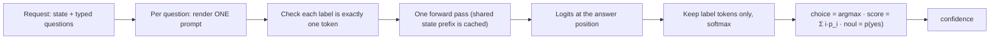

# Decision APIs vs language models, and how inference servers implement them

**Question:** Describe how a decisions API / System One API works compared with language models, and compare how LLM inference server software implemented those features.

This is a synthesis of [[system-one-model]], [[jev]], [[openai-decisions-api]], [[decision-api-server-implementations]] and [[decision-api-internals-prompt-output-confidence]]. For one request traced end to end, see [[decision-api-worked-example]].

## 1. A decision API versus a language model

A **decision API** is TypeSafe's `/v1/systemone` (for [[jev|Jev]]) or OpenAI's `/v1/decisions` ([[openai-decisions-api]]). It answers questions whose possible answers the caller lists in advance. It returns a typed value with a probability and generates no text ([[system-one-model]]).

| | Chat / completion LLM | Decision API (System One) |
|---|---|---|
| Request | Messages; output is open-ended | State plus typed questions: **choice** (pick one listed option), **score** (pick a level on an ordered scale), **noul** or "predicate" (probability a yes/no statement is true) |
| Output | Text, generated one token at a time | A label from the declared set, plus probabilities; an invalid answer is impossible |
| Computation | Prefill, then N decode steps | **Prefill, then one read of the next-token distribution** at the answer position, with zero decode steps (or one discarded step) |
| Probability | Logprobs, if exposed at all | The answer *is* the distribution: a softmax over the label tokens only |
| Price and speed | Charged per output token; latency grows with output length | Jev: 70–500 ms. OpenAI: "about 10x faster than the Responses API", input tokens only ($0.10 per 1M) |
| Can't do | — | Free text, rationales, any answer outside the declared set |

**What is new is the packaging, not the mechanism** ([[system-one-model]]). Reading a softmax over the listed answers is the 2020 [[mmlu|MMLU]] evaluation method ([[logit-scoring]]). The single-token label limit comes from PET (2020), and restricting output to legal answers is [[constrained-decoding]]. Only *training for calibration* could set it apart, and Jev's "RLCD" training is unpublished. TypeSafe's founder agreed with the description "Large Classification Model rather than a Large Language Model".

> [!warning] "Confidence" is not a calibrated probability
> Seven independent audits found Jev **overconfident**, with calibration varying by dataset (ECE 0.02–0.23, and 0.79 with no abstain option). Its `choice` probabilities behave close to a step function. Asking one `noul` per option and normalising cut Brier from 0.067 to 0.003 ([[independent-jev-calibration-audits-2026]]). OpenAI makes no calibration claim. Set thresholds from your own labelled examples ([[calibration]]).

## 2. The pipeline every server shares

No server answers several questions from one pass. **One question is one prompt row**, and the rows share the state prefix through the prefix cache ([[decision-api-internals-prompt-output-confidence]]).

## 3. How the servers implement it

Checked against source code on 2026-10-12 ([[decision-api-server-implementations]]).

| | [[sglang\|SGLang]] v0.5.21 | [[vllm\|vLLM]] `main` | [[ollama\|Ollama]] v0.35+ |
|---|---|---|---|
| Endpoints | `/v1/systemone` (released 2026-09-25); `/v1/decisions` in SGLang's own format, not OpenAI-compatible | `/v1/systemone` **on `main` only** (#59299, 2026-10-08); OpenAI-style Decisions is an open PR (#60465) | `/v1/systemone` only |
| Models served | **Any chat model** that passes the template and label checks | Qwen3, Qwen3.5 and DiffusionGemma only (an allowlist) | **Only tagged decision models** (Nimble, Tev1, Clef, Clef Flash) |
| Prompt | Its own generic wording via the model's chat template; `A:`…`Z:`, then two-letter labels up to 255 options | Similar generic wording; at most 26 options | **Replays the exact prompt format each model was fine-tuned on**; letters for every question type |
| Thinking mode | Forced off; templates that always reason are refused | `enable_thinking: false` is required | `Think: false` |
| How the distribution is read | **Prefill only, zero new tokens** (the `/v1/score` machinery); label logprobs over the full vocabulary | **One greedy decode step**: raw logprobs before temperature, label token IDs picked out; the token is discarded | **llama.cpp:** +100 logit bias on all candidates, top-k = number of candidates, one token. **MLX:** prefill, then unembed only the candidate rows |
| Off-label signal | `label_mass` | `label_mass` plus `argmax_is_label` | None: both paths never see the rest of the vocabulary |
| `confidence` formula | choice: `(n·max(q)−1)/(n−1)`; score: a spread-based formula | `p_top × label_mass` | `1 − H/ln K` (normalised entropy) |
| Best for | Serving an existing model as a decision endpoint on GPU | GPU deployments already on vLLM, once a release ships | Laptops, CPU and Apple silicon |

### The design difference

- **SGLang and vLLM** write their own generic question wording and rely on a capable chat model to follow it, so they serve general chat models.
- **Ollama** reproduces each decision model's training prompt exactly, so it serves only purpose-built models.
- **Hosted APIs** (Jev, gpt-6-luna) hide all of this; their internals aren't public.

A non-autoregressive route also exists. [[openjev|OpenJev]] reads [[diffusiongemma|DiffusionGemma]] untrained by masking only the answer slots on its canvas and doing one read-only pass. It came within about 3 points of Jev on Jev's own public cases but lost on cost ([[rationale-behind-diffusiongemma-as-jev]]).

### Problems found in the code

1. **The same model and question give three different confidence values** on the three servers, so thresholds don't transfer.
2. **Temperature means different things.** SGLang divides the label logits by it; vLLM's `temperature=0` only picks the discarded token; Ollama fixes it at 1.
3. **The yes/no prompt differs.** SGLang and vLLM use `yes`/`no`; Ollama uses `A`/`B`. vLLM had a bug where models answered "Yes" instead of `yes` (#60862).
4. **Answers depend on option order.** No server shuffles options; SGLang warns that two-letter labels make answers depend on option order.
5. **Results aren't fully deterministic.** SGLang warns answers can vary with batch composition and prefix caching. Pin the server version before tuning thresholds.

## Gaps

- The server comparison was code-checked on **2026-10-12**. The wiki has no record of whether vLLM has since released `/v1/systemone` or merged #60465.
- Hosted APIs' internals (Jev's RLCD, gpt-6-luna) are unpublished, so the hosted-versus-self-hosted comparison stops at the interface.
- llama.cpp on its own (outside Ollama), TensorRT-LLM and LM Studio aren't covered.

## References

- [[system-one-model]] · [[jev]] · [[openai-decisions-api]] · [[decision-api-server-implementations]] · [[decision-api-internals-prompt-output-confidence]] · [[decision-api-worked-example]]
- [[introducing-system-one-models-and-jev-typesafe-2026]] · [[openai-decisions-api-2026]] · [[decision-api-server-implementations-2026]] · [[ollama-decision-models-2026]] · [[independent-jev-calibration-audits-2026]]
