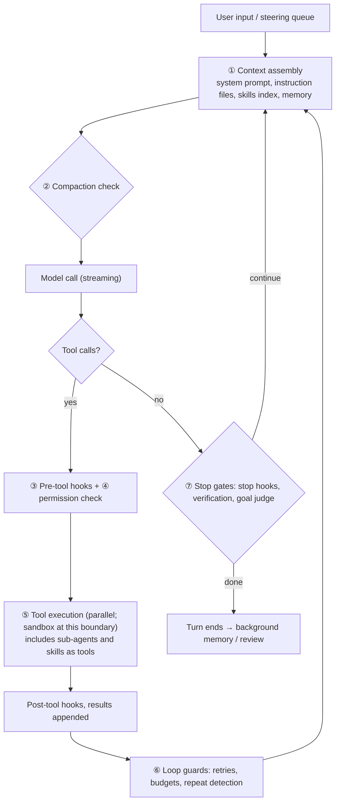

# Main agent components of the most popular agent harnesses, from their code

**Question (2026-11-18):** Among the most popular agent harnesses, what are the main components of the AI agent itself, read from the codebase? The user scoped it to the agent: the loop and what plugs into it, not servers, UIs or storage.

**Which harnesses.** Ranked by GitHub stars on 2026-11-18:

| Rank | Harness | Stars | Code read |
|---|---|---|---|
| 1 | [[openclaw]] | 395k | `9d6f4a94ad` |
| 2 | [[hermes-agent]] | 264k | `0e8e421640` |
| 3 | [[opencode]] | 228k | `79bd2c6f11` (V2, 2.3.0) |
| 4 | [[claude-code]] | 156k | no public source; see below |
| 5 | [[codex-cli]] | 136k | `4389a526d5` |
| 6 | [[pi-mono\|Pi]] | 123k | `f6d0c2f9b6` |

Claude Code's public repo has no source. Its column uses the wiki's existing architecture writeup of a **March 2026 leaked-sourcemap snapshot** ([[claude-code-agent-doc-2026]]), checked against the docs read on 2026-11-18 ([[claude-code-public-surface-study-2026]]). The leaked code itself was not read again, and the snapshot is about eight months older than the current product. Pi ranks sixth; it is kept as the minimal baseline.

The open repos were read only: nothing was built or run. Line counts are `wc -l` on the named files.

## The shape every harness shares

All six run the same loop. They differ in what is attached at each numbered point.

The loop itself is small everywhere: about 950 lines in Pi and OpenClaw's `agent-loop.ts`, about 1,700 in Claude Code's `query.ts` (snapshot), about 2,000 in Hermes's `conversation_loop.py` and about 4,000 in Codex's `turn.rs`. Most of each codebase lies outside the loop. Codex's agent core (`core` crate) is about 148k of about 1.21M non-test Rust lines. Hermes's core (`agent/` + `tools/`) is about 303k of about 1.16M Python lines. OpenClaw's agent core is about 270k of about 4.85M TypeScript lines. Pi's whole CLI stack is about 149k lines of TypeScript.

## 1. Agent loop

| Harness | Where | Shape | Stops when |
|---|---|---|---|
| OpenClaw | `packages/agent-core/src/agent-loop.ts` (932) `runAgentLoop` | outer follow-up loop, inner tool loop; host runner adds retry/failover (32–160 attempts) | no tool calls; abort; repeat guard; fatal tool error |
| Hermes | `agent/conversation_loop.py` (1,951) + 33 `turn_*.py` phases | each pass runs ~10 phases via `_run_phase`, which returns return/break/continue | text answer passes stop gates; iteration budget (unlimited by default); veto; watchdog (600 s) |
| opencode | `session/runner/*` (~3.3k) `SessionRunner.drain` → `runStep` | step outcome `needsContinuation` | no continuation; `agent.steps` (unset by default) |
| Claude Code | `query.ts` `query()`, wrapped by `QueryEngine` (snapshot) | `while(true)` state machine; sub-agents re-enter the same `query()` | no tool calls, then Stop hooks; docs add `maxTurns` / `maxBudgetUsd` |
| Codex | `core/src/session/turn.rs` (3,956) `run_turn` | outer loop while `needs_follow_up` | no follow-up, then Stop hooks (a block means continue) |
| Pi | `packages/agent/src/agent-loop.ts` (952) `runLoop` | inner tool loop plus follow-up loop | no tool calls; every call returns `terminate`; error or abort |

**Steering** (user input mid-run) is now standard. Codex drains an input queue each step. opencode separates "steer" (taken between steps) from "queue" (waits for the next turn). Pi polls at loop start and after each tool batch. Hermes attaches `/steer` text to the next tool results.

## 2. Tool definition and execution

| Harness | Registry → executor | Parallelism | Starts mid-stream |
|---|---|---|---|
| OpenClaw | `CORE_TOOL_DEFINITIONS` (68 ids) → `prepareToolCallExecution` | parallel by default | yes |
| Hermes | AST-discovered `registry.register` → `handle_function_call` → `ToolRegistry.dispatch` | read-only and path-disjoint calls only, 8 workers | no |
| opencode | `tool.ts` → `executeTool` forked per tool call | parallel | yes |
| Claude Code | `buildTool` → `runToolUse` (validate → PreToolUse → permissions → call) | docs: read-only tools concurrent, writes sequential | yes, `StreamingToolExecutor` (snapshot) |
| Codex | `build_tool_router` → `ToolOrchestrator::run` | `RwLock`: parallel-safe tools share, others exclusive | yes |
| Pi | 8 tools → `executeToolCallsParallel` | parallel; edits queued per file | no |

Two ways to keep parallel calls safe appear: **lock classes** (Codex, Claude Code) and **path planning** (Hermes, Pi). Tool errors go back to the model as tool output rather than ending the turn.

**Tool-surface reduction.** The model sees fewer tool definitions than the code has. Four of the six run model-written code that calls tools ("code mode"): opencode's `execute`, Pi's QuickJS codemode, Codex's V8 code mode and OpenClaw's experimental QuickJS mode. Four of the six defer catalogs behind a search tool: Claude Code's ToolSearch, Codex's and Hermes's `tool_search`, and OpenClaw's tool search, which is on by default.

## 3. Context assembly and system prompt

| Harness | How the prompt is built | How it changes during a session |
|---|---|---|
| OpenClaw | `buildAgentSystemPrompt` per attempt; context files in fixed order: AGENTS, SOUL, IDENTITY, USER, TOOLS, BOOTSTRAP, MEMORY | rebuilt per attempt; sub-agents get a minimal prompt |
| Hermes | three tiers: stable / context / volatile | built once and kept **byte-identical**; per-turn additions go into the user message |
| opencode | base prompt plus per-model plugin overrides; `context` hook each step | re-assembled each step |
| Claude Code | `constants/prompts.ts` + attachments (system reminders) | reminders injected per turn, e.g. plan mode |
| Codex | ~60 context fragments in `core/src/context/` | per-step **world-state diffs** instead of a rebuild |
| Pi | prompt sections | changed sections **appended as messages** |

The common pressure is the prompt cache. Hermes, Codex, Pi and Claude Code avoid rewriting the prompt prefix and add changes as new messages instead. Instruction files: AGENTS.md everywhere; Claude Code prefers CLAUDE.md. See [[context-engineering]].

## 4. Compaction

| Harness | Trigger | Method |
|---|---|---|
| OpenClaw | min(window − 16,384, 75%); preemptive check; on overflow | LLM summary, keep ~20k recent tokens; memory flush first |
| Hermes | 50% of window (75% floor under 512K); after each tool round; on overflow | prune old tool results (no LLM), then summary by an auxiliary model |
| opencode | 15% buffer (at least 16k) left | fixed summary template, keep ~15k; background precompute; native provider compaction |
| Claude Code | every turn (snapshot); near window limit (docs) | 5 stages: tool-result budget → snip → microcompact → collapse → autocompact; plus reactive compaction on overflow |
| Codex | min(limit, 90% of window); before, during and after a turn | local summary, server-side v2, or token-budget reset; speculative async |
| Pi | window − 16,384, between turns | LLM summary, keep 20k; one compact-and-retry on overflow |

Pattern: **cheap pruning first, then an LLM summary, plus a reactive pass on overflow.** See [[context-compaction]].

## 5. Long-term memory

| Harness | Memory |
|---|---|
| OpenClaw | `memory-core` plugin (~48k lines): SQLite vector + full-text search, `memory_search`/`memory_get`, "dreaming" consolidation |
| Hermes | frozen `MEMORY.md`/`USER.md` snapshot, provider plugins, FTS session search, background review fork |
| opencode | none (session log and compaction summaries only) |
| Claude Code | `MEMORY.md` index + topic files (docs); snapshot also had `extractMemories` and `autoDream` |
| Codex | background two-phase pipeline; a consolidation sub-agent writes `~/.codex/memories`; memory tools |
| Pi | none in core |

The split follows the product: personal assistants (OpenClaw, Hermes) carry heavy memory, while coding-first agents carry little or none. Where memory exists, a **background sub-agent consolidates it after or between sessions**. See [[memory-management]].

## 6. Planning, todo and goal

| Harness | Todo / plan | Goal loop | Who judges "done" |
|---|---|---|---|
| OpenClaw | `progress_card` checklist (shown in the UI only) | `/goal`: continuation turns, token budget | the working model (`update_goal`) |
| Hermes | inline todo tool, re-injected after compaction; `/plan` is only a prompt | `/goal` runs **outside** the loop: shell gates, then judge; 20 turns | separate judge model |
| opencode | todo tool, plan plugin | goal plugin: 50 rounds, pauses after 3 stalls | separate reviewer with no tools |
| Claude Code | plan mode, todo tool | `/goal` = prompt-based Stop hook | small separate model |
| Codex | `update_plan` is stateless (UI event only); plan mode needs user approval | `ext/goal`: continuation when the thread goes idle, budget wrap-up | the working model |
| Pi | none in core (example extensions) | none | — |

A goal is a **loop around the loop**: it re-drives the agent with continuation turns. See [[harness-extension-and-goal-loop-axes]].

## 7. Sub-agents

| Harness | Mechanism | Limits |
|---|---|---|
| OpenClaw | `sessions_spawn`, `subagents`, `sessions_yield` | depth 5, swarm mode on by default |
| Hermes | `delegate_task` builds a child agent with its own history | depth 1, 250 iterations, blocked-tool list |
| opencode | `subagent` tool, always background | depth 1 |
| Claude Code | Agent tool → `runAgent`, re-enters `query()` | docs: depth 3, 20 concurrent |
| Codex | `spawn_agent` family; each child is a full thread | depth 1, 6 threads; roles can only narrow permissions |
| Pi | none in core | — |

Everywhere a sub-agent is **the same loop, called as a tool**, and its result returns as context. Several harnesses reuse it internally: Codex for review, its Guardian reviewer and memory consolidation; Hermes for background review. See [[subagents]].

## 8. Skills

All six load `SKILL.md` files with **progressive disclosure**: a short index goes into the prompt, and the body is loaded on demand. Pi loads it with its ordinary read tool; the others have a skill tool. Hermes alone lets the agent write its own skills (`skill_manage`) and scans external ones (`skills_guard`). See [[agent-skills]].

## 9. Hooks: where code can intercept the loop

| Harness | Count | Can block a tool | Can force the loop to continue |
|---|---|---|---|
| OpenClaw | 43 plugin + 15 internal | yes; can also require operator approval | — |
| Hermes | 48 + 4 middleware + shell hooks | yes (`pre_tool_call`, shell exit 2) | `pre_verify` |
| opencode | 21 | only `tool.execute.before` | goal plugin uses `idle` |
| Claude Code | 33 (docs; 27 in snapshot) | yes | Stop hook |
| Codex | 14 | yes; can rewrite input | Stop hook (block = continue) |
| Pi | 41 extension events | yes (`tool_call`) | `agent_before_settle` |

Two interception points matter most: **before a tool runs** (block or rewrite) and **when the model wants to stop** (force continuation). See [[hooks-in-modern-agents]].

## 10. Permissions and the sandbox boundary

| Harness | Where the check sits | Default | Sandbox around tool execution |
|---|---|---|---|
| OpenClaw | wrapper around every tool; exec approvals; LLM auto-reviewer; turn taint | exec full, no prompt | off by default; Docker / Podman / SSH |
| Hermes | **inside** tool handlers; hardline patterns; parallel calls share one approval lock | manual | 6 backends, bound per task |
| opencode | **inside** each tool (`Permission.assert`); last matching rule wins | allow, except `.env` reads | none (code-mode interpreter only) |
| Claude Code | central check in `runToolUse`; rules deny → ask → allow; classifier | auto mode (docs) | Bash only, off by default |
| Codex | central `ToolOrchestrator::run`: policy → user or Guardian review → run | 4 policies; reviewer defaults to user | wraps each command; unsandboxed retry needs a fresh approval |
| Pi | project trust only | — | none (codemode only) |

A denial goes back to the model as a tool result in every harness. The sandbox is never a loop stage. It wraps a single command at execution time. See [[guardrailing]].

## 11. Loop guards and error recovery

| Harness | Guards |
|---|---|
| OpenClaw | repeat guard (note on 3rd identical call, stop on 20th); repetition guard "adapted from Hermes"; run retry budget 32–160 with model failover; separate session retry (3) |
| Hermes | the most complete set: error classifier with retry / rotate / fallback / compress hints; identical-call threshold 3; cycle detection; repetition guard; empty-response guard; 600 s liveness watchdog; iteration budget with refunds |
| opencode | retries (2 s → 10 s, ×10); restart cap 10; tool-input repair; no doom-loop guard in V2 |
| Claude Code | model fallback, one reactive compaction (snapshot); `maxTurns` / `maxBudgetUsd` (docs) |
| Codex | retry caps (5 stream, 4 request); spend budget shared by the thread tree; no turn cap or repeat detection |
| Pi | 3 retries and one compact-and-retry, both **after** the loop returns; no cap or repeat guard |

## 12. Verification before stopping

| Harness | Built-in check |
|---|---|
| Hermes | stop gates turn a final answer back into a nudge: late LSP errors, **verify-on-stop** (code edited but no check run, up to 3 nudges), `pre_verify` hook, kanban guard; then background review |
| Claude Code | snapshot had a verifier sub-agent returning PASS / FAIL / PARTIAL; current docs offer only a `/verify` skill |
| opencode | the goal reviewer only |
| Codex | none in the loop; review sub-agent, Guardian pre-check and Stop hooks |
| OpenClaw | no verifier model; a `before_agent_finalize` hook can return "revise" and force another model pass (capped) |
| Pi | none |

Only Hermes forces a check before stopping by default. OpenClaw offers a hook-driven revise pass. Elsewhere, verification is a hook or a skill the user adds. See [[plan-execute-verify-loop]].

## Summary: core vs. optional

- **In all six:** the loop, tools with parallel execution, context assembly, compaction, skills, hooks and some permission gate.
- **In five:**
  - sub-agents and goal loops (not in Pi's core);
  - steering;
  - tool-surface reduction, through code mode or tool search.
- **Optional, and where the six differ most:**
  - long-term memory;
  - a sandbox on by default (Codex only);
  - loop guards: Hermes has the most;
  - forced verification: Hermes only (OpenClaw has a hook-driven revise pass).

This ranking extends [[fundamental-components-of-harness]], which lists eight universal components. Code adds three that its framework sources underweight: **compaction**, **steering** and **loop guards**. Per-harness evidence is in [[openclaw-codebase-study-2026]], [[hermes-agent-codebase-study-2026]], [[opencode-codebase-study-2026]], [[claude-code-agent-doc-2026]], [[codex-cli-codebase-study-2026]] and [[pi-codebase-study-2026]]. The wider ten-agent comparison is [[agent-harness-code-study-2026-11]].

## References

- [[openclaw-codebase-study-2026]] · [[hermes-agent-codebase-study-2026]] · [[opencode-codebase-study-2026]]
- [[claude-code-agent-doc-2026]] · [[claude-code-public-surface-study-2026]] · [[codex-cli-codebase-study-2026]] · [[pi-codebase-study-2026]]
- [[agent-harness-code-study-2026-11]] · [[fundamental-components-of-harness]] · [[hooks-in-modern-agents]]
