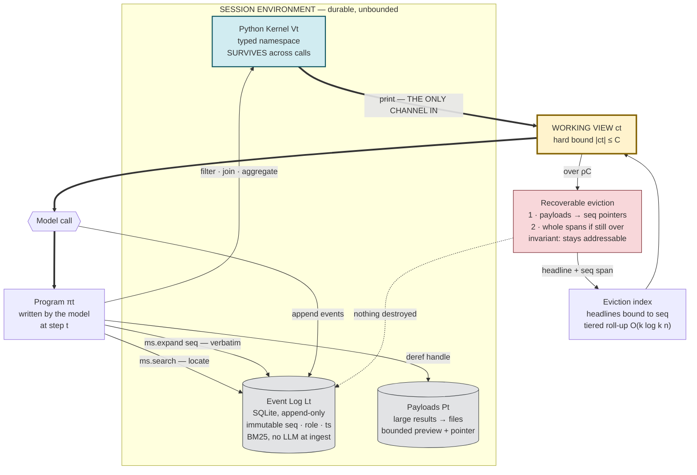

# Context as an Environment: Programmatic Context Management for Long-Horizon Agents

**Yin Lin, Elaine Ang, Erkang Zhu, Bolin Ding, Jingren Zhou** ([[alibaba|Alibaba Group]]; Ang at Columbia University, work done during an Alibaba internship; Lin and Ang equal contribution) — [arXiv:2608.21690](https://arxiv.org/abs/2608.21690), cs.AI, 21 Aug 2026, v1, CC BY 4.0. Self-described as a "report"; no venue. Code: `github.com/niceIrene/QwenPaw/tree/scroll-research`. The system is called **Scroll**.

## Summary

Every existing answer to "the history is bigger than the window" — compaction summaries, and external memory stores built by fact extraction or knowledge-graph construction — makes the same commitment: it decides **what survives before it knows what will be needed**. The paper formalizes this. Session state is `S_t = (L_t, P_t, V_t)` (event sequence, payloads, derived state); each call sees a working view `c_t` with `|c_t| ≤ C`; the context-management problem is the map `S_t ↦ c_{t+1}`. Compression fixes that map as a lossy operator `φ` applied as the trajectory grows; external memory fixes an extraction operator `ψ` at ingestion. Either way the reduced representation *replaces* the history, so anything omitted is unrecoverable even though the raw log still exists on disk.

Scroll defers the choice to query time by making the map a **program `π_t` the model writes at step t**. The session becomes an executable **Session Environment** with three parts: an **append-only Event Log** `L_t` (SQLite; every event gets an immutable monotonically increasing `seq`, plus role, session/agent ids, timestamps, tool state; search is [[bm25|BM25]] by default — deterministic, no index-time model calls), **durable storage** `P_t` (large tool results and artifacts externalized to files, with a bounded preview and a recovery pointer in the row, accessed through lazy `ToolResultRef`/`ArtifactRef` handles), and a **sandboxed persistent Python kernel** `V_t` whose typed namespace survives across model calls. The model-facing surface is a capability object `ms` with four operations — `ms.search` (locate), `ms.expand(seq)` / `ms.expand(lo, hi)` (materialize verbatim), ordinary Python (compute), and `print` (expose). The rule that does all the work: **`exec` decides how the environment is accessed and transformed; `print` decides what enters the next model context.** Tool outputs bind to variables instead of being serialized into the prompt; the harness prepends a short *namespace digest* (name, type, shape, small scalars inline) to each call; the kernel is fail-closed (Event Log read-only, filesystem/network/tool access only by declared capability). This is a [[codeact|CodeAct]]-style interface applied to the agent's own history — the same move as [[programmatic-tool-calling]], extended from tool results to the whole session.

Bounding the view is done by **recoverable eviction** (Algorithm 1), triggered when `|c| > ρC`. Live turns are persisted; the active turn, recent tail, and newest tool results are protected; then the rest is removed in increasing order of recovery cost — completed tool payloads are folded to `seq` pointers first, whole spans only if still over budget. The single invariant: **everything removed stays addressable**. To keep the agent aware of what it can no longer see (search only recovers what the agent thinks to ask for), each model response includes a short *headline* (task, verified state, next action, status) bound at append time to its `seq`; evicted spans' headlines enter a tiered **eviction index** shown in place. Each tier holds at most `k` blocks; on overflow the newest keeps full detail, the `k−1` older collapse to one line each and merge into the next tier, so after `n` evictions the index occupies `O(k log_k n)` blocks — fine anchors for recent history, coarse ranges for distant history, every entry backed by a `seq` span.

Headline results, all with Qwen3.8-Max (a [[qwen]] model) on the QwenPaw agent OS orchestrated with Harbor: **94.8% LongMemEval_S**, **73.1 on BEAM_10M** (+5.1 over the best published system), **86.7% LOCA_256K** (+37.4 over the best published long-horizon agent). All three newsletter numbers verify. The ablation is the more instructive result: discarding originals at ingestion collapses BEAM_10M to **19.9**, removing the persistent kernel costs **7.3**, removing the eviction index costs **1.8**.

## The loop

Read the diagram by the **asymmetry between the two thick edges**. `exec` reaches the whole environment — the full log, every payload, arbitrary computation — while `print` is a narrow one-way valve into the next context. The paper's one-line statement of it: *"`exec` decides how the environment is accessed and transformed; `print` decides what enters the next model context."*

Three consequences follow directly from the shape:

1. **The unbounded box and the bounded box are different boxes.** The Event Log grows forever; the working view never exceeds `C`. Compaction and external-memory systems collapse these two into one, which is why their reduction has to be decided at write time.
2. **The dashed edge is the whole design.** Eviction removes things from the view and *never* from the log, so the map from history to context is recomputed per query rather than committed once.
3. **The index exists because search is not enough.** Lexical search only recovers what the agent thinks to ask for, so evicted spans leave a headline behind — the agent stays aware of what it can no longer see. That is also the residual weakness: headlines record task, verified state, next action and status, **not constraints**.

## Key points

**Comparison with long-term memory systems** (Table 2). This is explicitly *not* a controlled comparison: each baseline is its best publicly reported number under its own backbone/retrieval budget/judge as of 15 Aug 2026 (readers range from GPT-4o to Gemini 3 Pro), and the authors decline to reproduce baselines because "independent reproductions in this area have repeatedly led to disagreement over evaluation setup."

| System | LongMemEval_S | BEAM_10M |
|---|---|---|
| RAG | – | 24.9 |
| LIGHT | – | 26.6 |
| [[zep\|Zep]] | 90.2 | – |
| [[mem0\|Mem0]] | 94.4 | 48.6 |
| Hindsight | 94.6 | 64.1 |
| EmergenceMem | 86.0 | – |
| Honcho | 90.4 | 40.6 |
| Mastra OM | 94.9 | – |
| Cognee | – | 67.0 |
| Exabase M-1 | **96.4** | 68.0 |
| **Scroll** | 94.8 | **73.1** |

So on LongMemEval_S Scroll is *competitive* (Exabase M-1 and Mastra OM are higher); the +5.1 win is on BEAM_10M, where histories (10M tokens) cannot be consumed within any current window. Every baseline is a three-stage pipeline (ingest → derived store → retrieve → separate reader); Scroll ingests raw history as-is with **no LLM calls at ingestion**, composes retrieval code per question, and needs no reader — the agent that writes the queries answers directly.

**BEAM_10M by memory ability** (Table 6, against the three baselines with public per-category numbers; indicative, not controlled):

| Category | Mem0 | Hindsight | Exabase M-1 | Scroll |
|---|---|---|---|---|
| Information extraction | 56.2 | 51.2 | 66.3 | **75.0** |
| Multi-session reasoning | **26.1** | 16.6 | 9.6 | 21.9 |
| Event ordering | 20.2 | 61.6 | **67.5** | 64.1 |
| Temporal reasoning | 16.3 | 41.3 | **58.8** | 47.5 |
| Knowledge update | 75.0 | 65.0 | 45.0 | **92.5** |
| Contradiction resolution | 32.5 | 56.9 | 58.8 | **88.1** |
| Summarization | 46.9 | 78.2 | **91.9** | 70.5 |
| Preference following | 90.4 | **97.5** | 95.0 | 89.1 |
| Instruction following | 82.5 | 92.5 | **97.5** | **97.5** |
| Abstention | 40.0 | 80.0 | **90.0** | 85.0 |
| Overall | 48.6 | 64.1 | 68.0 | **73.1** |

The profile is the paper's real argument. Scroll wins by the widest margins exactly where the answer hinges on a few exact records that must be located, ordered, and reconciled — knowledge update, contradiction resolution, information extraction — because "resolving an update or a contradiction needs both sides of the value timeline, in order, with provenance," which write-time compression destroys (the authors note Mem0's add-only extraction preserves old facts and so holds up at 75.0 on knowledge update). It *loses* where the graded artifact is itself a condensed view — summarization (70.5 vs 91.9), preference following, temporal reasoning — because ingestion-heavy pipelines have already built the digest when the question arrives, and Scroll must reconstruct it per query. Multi-session reasoning is the weakest category for *every* system (9.6–26.1); Scroll's misses there are "over-precise filters that undercount the evidence set," i.e. query formulation, not unreachable records.

**LongMemEval S → M** (Table 5; ~115K → ~1.5M tokens of history, ~50 → ~500 sessions): overall **94.8 → 89.6**. Single-session user/assistant stay at 98.6–100; the degradation concentrates in multi-session (88.0 → 81.2) and single-session preference (100.0 → 83.3) — with more distractor sessions the model-written code "reliably locates a single supporting session but often misses part of the evidence."

**LOCA — controlled comparison of context strategies** (Table 3; same backbone, same tools, only the context-management loop differs; Δ is the 128K→256K drop):

| Agent loop | 128K | 256K | Δ |
|---|---|---|---|
| Summarization agent ([[react\|ReAct]] + periodic compaction) | 86.7 | 65.3 | −21.4 |
| Retrieval agent (ReAct + evict-and-recall tool) | 88.0 | 66.7 | −21.3 |
| CodeAct agent (programmatic tool calling) | 89.3 | 85.3 | −4.0 |
| **Scroll** | 89.3 | **86.7** | **−2.6** |

Two readings. First, the persistent-kernel idea alone (plain CodeAct) captures almost all of the robustness: binding intermediate results to environment objects instead of carrying raw text is what flattens the curve, and Scroll adds 1.4 pp on top. Second, summarization and retrieval-by-tool lose about the same amount (~21 pp) — making history *recoverable* through a recall tool on a ReAct loop does not by itself help; what helps is not putting serialized text in the window in the first place. The **+37.4** headline is against published systems with *different* backbones (Table 7: GPT-5.2-Medium + ReAct 21.3, [[anthropic|Claude]]-4.5-Opus + ReAct 14.7, MiniMax M3 + ReAct **49.3** at 256K; GPT-5.2-Medium + PTC 49.3 at 128K only) — system-level, so the 37.4 conflates backbone and harness.

**Across backbones** (Table 4; harness, tools, prompts, rules fixed):

| Backbone | LongMemEval_S | BEAM_10M | LOCA 128K | LOCA 256K |
|---|---|---|---|---|
| Qwen3.8-Max | 94.8 | 73.1 | 89.3 | 86.7 |
| Qwen3.7-Max | 92.8 | 66.6 | 78.7 | 60.0 |
| [[deepseek\|DeepSeek]]-v4-pro | 93.2 | 70.2 | 69.3 | 58.7 |
| [[glm-5-2\|GLM-5.2]] | 93.6 | 70.7 | 66.7 | 62.7 |
| Kimi-K2.7 ([[moonshot-ai]]) | 92.0 | 67.2 | 30.7 | 32.0 |
| Qwen3.6-35B-A3B | 88.8 | 58.1 | 37.3 | 22.7 |

Every backbone can use the interface (no protocol-level failures), and on the short-program benchmark the spread is small — the 35B open-weight model reaches 88.8 on LongMemEval_S, within six points of the best. On LOCA the spread is **64 points** at 256K (86.7 vs 22.7): weaker models commit execution errors or stop early on aggregation-heavy tasks. The ceiling is therefore set by multi-step query planning and knowing when evidence suffices — which is why the conclusion proposes distilling frontier traces into smaller models, supervising two decisions (when/how to write retrieval code; what to print back).

**Ablation on BEAM_10M** (Figure 3, Qwen3.8-Max, thinking on):

| Variant | Overall | Where it hurts |
|---|---|---|
| Lossy summarization (summaries replace originals at ingestion) | **19.9** | near-zero wherever exact values are needed: information extraction, temporal reasoning, knowledge update |
| Scroll w/o REPL (`search`/`expand`/`sql_query` as plain tool calls, no kernel) | −7.3 | knowledge update 92.5 → 82.5; instruction following 97.5 → 76.3; single-lookup abilities unaffected |
| Scroll w/o eviction index (keyword search only) | −1.8 | preference following 89.1 → 74.9; summarization 70.5 → 62.6; event ordering 64.1 → 58.1 |
| Full Scroll | 73.1 | |

The ordering matters: losslessness is worth ~53 points, the kernel ~7, the index ~2. The index earns its keep specifically where evidence is scattered and the agent would otherwise have to guess search terms.

**Cost.** Ingestion is free of LLM calls; at query time the kernel filters records so only printed output enters the context. Median input on BEAM_10M is **105K tokens — about 1% of the 10M corpus**; output is an order of magnitude smaller than input on all three benchmarks. LongMemEval and BEAM measure retrieval alone, LOCA measures full task completion (hence longer trajectories). Only token counts are reported — no latency, no dollar cost — "as both depend on serving configuration."

**Protocol details worth keeping.** LongMemEval and BEAM are judged by their own LLM-as-judge prompts with Qwen3.6-flash at temperature 0; LOCA by its rule-based verifier on final environment state. For the memory benchmarks, history is ingested session by session; at each session boundary the raw context is cleared and only the eviction index and Event Log carry forward. Single run per task, random seed. One system prompt and one rule set across all benchmarks, no few-shot demos; each memory benchmark adds only a short rubric on data layout and answer format. The BEAM rubric (Appendix C) is quite prescriptive — it tells the model to start with `k=5` or `k=10`, to search entities separately rather than AND-ing them, and to filter dates via `ms.sql_query` on `created_at` — so "no few-shot" does not mean "no benchmark-specific guidance."

## Is the append-only Event Log an instance of catastrophic remembering?

No — and the reason is precise. [[catastrophic-remembering]] is a ratchet on **context the model is made to read**: instruction files, skill libraries, and memory stores whose accumulated content is loaded into the prompt, where additions are cheap, outcomes are censored so deletion evidence never arrives, and redundancy makes honest pruning exponential. The harm requires the accumulation to *reach the working view*. Scroll's log grows without bound, but it is the durable record, not the prompt: the working view is hard-bounded at `ρC` by Algorithm 1, and the only thing that crosses from log to view is what a model-written program explicitly prints. The design also supplies exactly what the catastrophic-remembering page identifies as the missing ingredient — **provenance**: every event carries `seq`, role, timestamps, and tool state; every resident variable carries type, size, and the events it derives from. Nothing in Scroll accumulates self-generated instructions with censored outcomes. Structurally it belongs with the *fixes* that page lists (retrieval instead of replay), not the disease — and unlike verbatim replay ([[memharness-memory-is-reconstructed-not-replayed-wu-2026]]'s negative-transfer result) the `expand → filter/join in kernel → print` path reconstructs a projection rather than pasting old text.

Two residual channels are worth naming. (1) The **eviction index** *is* self-written material (headlines) that stays in the view; it is bounded to `O(k log_k n)` blocks by roll-up, so growth is logarithmic and the roll-up is lossy only in the view, never in the log. (2) The store-side half of the concept — "grows without bound **and degrades in value**" — resurfaces as **retrieval precision** rather than prompt bloat: LongMemEval S → M drops 94.8 → 89.6 as distractor sessions grow 10×, and multi-session reasoning stays the weakest category everywhere. Scroll relocates the cost of an unbounded store from the context window to the search problem; it does not remove it.

A sharper concern comes from [[lost-in-compaction-side-constraint-loss-wang-2026]]: Scroll's eviction never destroys a side constraint, but the headlines that stay in view record *task, verified state, next action, status* — not constraints — so a "confirm with me before deleting anything" stated 200 turns ago is recoverable only if the agent thinks to search for it. The paper itself concedes that "lexical search recovers an evicted span only when the agent recalls its wording." Scroll converts silent constraint loss into a did-the-model-look problem; it does not solve it.

## Limitations

- **Uncontrolled headline comparisons.** Both "+5.1" and "+37.4" are against published numbers under different backbones, retrieval budgets, and judges; the authors say so explicitly, but the abstract quotes the margins without the caveat. The controlled evidence is Table 3 (Scroll vs CodeAct: +1.4 at 256K) and the ablation.
- **The kernel, not Scroll, carries most of the LOCA result.** Plain CodeAct already reaches 85.3 at 256K.
- **No latency or cost.** Token counts only; a persistent Python kernel plus SQLite plus BM25 per session is a real serving footprint that is never characterized.
- **`ρ` and `k` are never given numerically** in the main text; the budget fraction and tier width are left as symbols.
- **Single run per task, no variance.** The authors say the category profile is "consistent across our repeated runs" but report one.
- **Where the digest is the answer, Scroll loses** (summarization 70.5 vs 91.9). Query-time reconstruction is not free.
- **Backbone-dependence on long trajectories** (64-point spread) means the "inherits improving coding abilities" pitch is also a dependency: the harness is only as good as the model's multi-step query planning.
- Within-session eviction is evaluated on benchmarks that clear raw context at session boundaries; the log spans sessions, but long *within-session* eviction behavior is exercised only by LOCA.

## Related

- [[memory-management]] · [[long-term-memory]] · [[episodic-memory-llm]] — Scroll is a memory system that refuses to build a memory store: the raw episode log *is* the store.
- [[virtual-context]] · [[tiered-memory]] · [[memgpt]] · [[memgpt-packer-2023]] — the lineage. Hot = working view, warm = eviction index, cold = Event Log; the LLM is still the scheduler, but it schedules by writing programs rather than emitting paging calls.
- [[codeact]] · [[codeact-wang-2024]] · [[programmatic-tool-calling]] · [[code-as-harness]] · [[code-as-agent-harness-ning-2026]] — the interface Scroll generalizes from tool results to session history; Table 3 shows CodeAct alone gets most of the robustness.
- [[pro-long-programmatic-memory-fox-2026]] — the closest sibling: dumb append-everything `write`, programmatic (grep/Python) `read`, "accessed vs accessible" context. Scroll adds the persistent kernel, stable addressing, recoverable eviction, and the index. Two groups converging on the same design in one summer.
- [[harness-1-state-externalizing-search-agents-jiang-2026]] — same thesis (bookkeeping belongs in the environment, semantic decisions in the policy) applied to search agents and trained with RL.
- [[acm-agentic-context-management-li-2026]] — also lossless and agent-initiated, but keeps a summary in context and offloads raw messages to disk behind a querier LLM; Scroll keeps raw records addressable and computes over them in-kernel with no second model.
- [[zero-mem-zero-token-memory-operations-xiao-2026]] — shares zero-LLM ingestion and lexical (BM25) indexing over original traces as the source of record; differs in having no executable kernel.
- [[grep-all-you-need-sen-2026]] — grep-style retrieval on LongMemEval_S; note that paper's 116-question subset is not the ~50-session S split used here.
- [[catastrophic-remembering]] · [[why-does-claude-md-keep-growing-chakrabarti-2026]] · [[memharness-memory-is-reconstructed-not-replayed-wu-2026]] — see the section above: bounded view plus provenance defuses the prompt-side ratchet; store-side growth reappears as retrieval precision.
- [[lost-in-compaction-side-constraint-loss-wang-2026]] — eviction never destroys a side constraint, but headlines do not carry constraints, so recovery depends on the agent searching.
- [[memory-evolution]] · [[memory-construction]] · [[mem0]] · [[mem0-chhikara-2025]] · [[zep]] — the write-time paradigm Scroll argues against; Mem0's add-only extraction is the one baseline that survives on knowledge update.
- [[prompt-compression]] — the "lossy summarization" ablation (19.9) is the cleanest in-paper measurement of what write-time compression costs on exact-value questions.
- [[longmemeval]] · [[agent-benchmark]] · [[llm-as-a-judge]] — LongMemEval and BEAM are LLM-judged (Qwen3.6-flash); LOCA is verifier-scored.
- [[context-assembly]] · [[agentic-harness-engineering]] · [[agent-three-layer-model]] — Scroll is an L2 design in which the model writes its own assembly step.
- [[long-context-llm]] — motivated by effective context being far smaller than nominal context.
- [[bm25]] — default search, chosen for determinism and zero index-time model calls.
- [[alibaba]] · [[qwen]] · [[deepseek]] · [[glm-5-2]] · [[moonshot-ai]] · [[anthropic]] · [[openai]] — backbones and published baselines.

## References

- [arXiv:2608.21690](https://arxiv.org/abs/2608.21690) · code: `github.com/niceIrene/QwenPaw/tree/scroll-research`
- Wang et al. 2024, *Executable Code Actions Elicit Better LLM Agents* (CodeAct) — the action interface.
- Wu et al. 2025, *LongMemEval*; BEAM (10 memory abilities, 128K–10M histories); LOCA (long-context reasoning-and-acting, 8K–256K environment descriptions) — the three benchmarks.
- QwenPaw (AgentScope team, 2026) and Harbor — the agent OS and orchestrator all methods run on.
- Anthropic 2025, programmatic tool calling / code execution — cited as the tool-result precedent for "only projections enter context."
